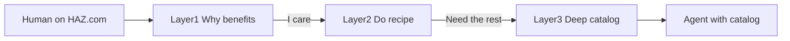

# HAZ.com: benefits first, human to agent

## The problem

We already have complete kit truth in HQ catalogs (for example [`.agents/catalog/shortcodes.md`](../catalog/shortcodes.md) for `haz_img`). That layer is right for agents and for humans who already care.

Mom (and a first-time visitor) does not start caring. Without a clear why, the same material reads as Martian. Pasting catalog prose into a blog post recreates the TMI mess.

**Direction of travel (locked):** humans find HAZ.com, then think they should show it to their agent(s). Not the other way around. Agents do not evangelize HAZ; people do.

Do **not** rewrite `shortcodes.md` for Mom. Keep it as the deep / complete surface. Change what we **publish** when we turn that material into HAZ.com posts.

## Three layers (same topic, different jobs)

- **Layer 1 — Why** (HAZ.com How To / blog): benefits in plain language; one job per piece. Lead with outcomes. Stop when the reader knows why it exists.
- **Layer 2 — Do** (same post or a short follow-on): the smallest recipe (paste this; use these 3 to 5 names). No `settings.yaml` tour unless the reader asked how it works.
- **Layer 3 — Deep** (HQ `.agents/catalog/`, later a for-agents link): complete contract (attrs, settings, before/after HTML). Catalogs stay complete. Agents get pointed here on purpose.

Every public piece must clear a **benefits gate** before it earns a deep section: if you cannot say why someone should care in two bullets, you are not ready to publish that post.

## Exemplar: `haz_img` benefits (use these words)

When HAZ.com talks about `haz_img`, lead with:

1. **Automation** — it adds `sizes` and `srcset` to your HTML `img` tags so you do not hand-write them.
2. **Faster pages** — `sizes` + `srcset` let the browser choose a better image file; smaller cumulative payload, faster loads.

Only after that: named presets, Mom’s 3 to 5 keys, then (optional / linked) the catalog under-the-hood and before/after markup.

Designer work (preset bank, `width_px`, breakpoints) stays Layer 2 to 3. Mom never needs the matrix to believe the benefit.

## How to break all of HAZ without a dump

- **One benefit cluster per post**, not everything HAZ. Example clusters: images that load right (`haz_img`); callouts / tabs / grids (`haz_do`); search that feels like the site; fluid type that fits the column ([#54](https://github.com/hugo-agent-zero/hugo-agent-zero/issues/54)).
- **Map, do not encyclopedia.** Home / Getting Started answer what HAZ is in a few jobs and point to How To posts. Cheatsheet ([#112](https://github.com/hugo-agent-zero/hugo-agent-zero/issues/112)) is a map of names to one-liners, not a second catalog.
- **Catalogs stay HQ-first.** [#145](https://github.com/hugo-agent-zero/hugo-agent-zero/issues/145) through [#153](https://github.com/hugo-agent-zero/hugo-agent-zero/issues/153) keep building agent-complete truth. Public posts cite or paraphrase benefits; they do not mirror catalog structure section-for-section.
- **End every How To with an agent handoff.** Explicit CTA: paste this post (or this catalog link) into your agent. That is the product motion.

## What this is not

- Not a rewrite of existing catalogs.
- Not one mega post that is complete and Mom-friendly. Completeness lives in Layer 3; meaning for humans lives in Layers 1 to 2.

## When we write (later)

1. Draft How To posts as benefits, then recipe, then optional deep / agent link.
2. First concrete pass: a `haz_img` How To that opens with the two benefits above (replaces Lorem on the stub from the HAZ.com starter plan / [#21](https://github.com/hugo-agent-zero/hugo-agent-zero/issues/21)).
3. Keep HQ catalogs growing in parallel as the SoT the agent is shown.

## Success test

A non-technical reader can finish the first screen of a How To and answer why they should care. A technical reader (or an agent) can follow one link and get the full contract without the public post trying to be that contract.
